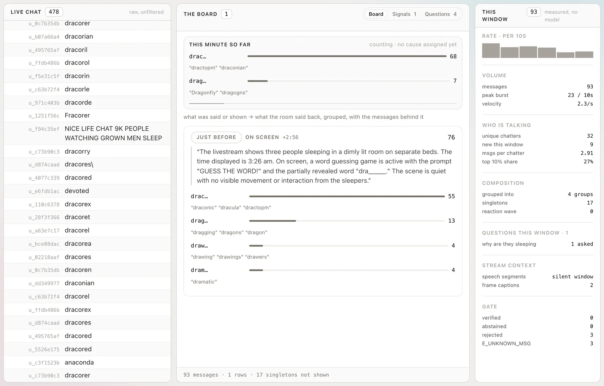
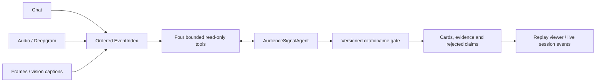

# Twinky — audience signals from Twitch chat, speech and screen

A fast Twitch chat tells you what viewers typed. Understanding what they are reacting to also
requires the stream. Twinky puts chat, speech transcripts and frame captions on one timeline,
then uses a tool-calling agent to propose answers, reactions, questions and warnings with citations.
Its gate checks evidence mechanically; causal explanations remain hypotheses for a person to inspect.

**Today:** a multimodal research prototype with real captured broadcasts, a working replay
viewer, cached evaluation, and an experimental live pipeline behind a bounded session API.
**Next:** a public website where a visitor enters any Twitch username. That website is not
implemented or deployed here. Live network/provider execution has not been revalidated in this
engineering pass; the API integration is tested offline with the real agent and recorded fixtures.

`make eval` reproduces the published comparison with **48 cache hits, 0 API calls**.
The agent **loses the unsupported-card rate** to the chat-only diagnostic (0.609 vs 0.280).
No matched prediction identifies the correct speech or frame trigger. The gold labels are
model-drafted and **not yet author-confirmed**. These are exploratory results, not product accuracy.

<p align="center">
  
</p>

The real replay viewer on the recorded `c07_frame_only_dracorex` window. The deterministic board
groups 76 guesses across four groups. This screenshot predates the current gate projection;
its gate ledger is historical. Board links are lexical or temporal suggestions, not demonstrated
causes. The current viewer labels its gate version and rescoring source; no model is called by replay.

[Run it](#running-locally) · [Results](#results-at-a-glance) ·
[Architecture](#how-it-works) · [Live API](docs/LIVE_DEMO_INTEGRATION.md) ·
[Evaluation](docs/EVALUATION.md) · [Attribution](#my-contribution)

## Results at a glance

Eleven frozen cases from four captured broadcasts, with overlapping windows in two pairs.
Every emitted card is scored, including rejects. Source: [published summary](evidence/summary.json).

| system | cards | trigger accuracy | unmatched | unsupported | recall |
|---|---:|---:|---:|---:|---:|---:|
| agent | 23 | 0.500 | 0.913 | 0.609 | 0.182 |
| baseline | 21 | 0.000 | 0.952 | 0.619 | 0.091 |
| ablation (chat only, diagnostic) | 25 | 1.000 | 0.960 | 0.280 | 0.091 |

Trigger accuracy is conditional on a type/evidence-overlap match to a gold label. The two correct
trigger matches across the agent and diagnostic are `unknown`, not speech or screen. All three
systems fail the one must-abstain case. A low unsupported rate measures fewer citation/time
violations, not semantic precision or successful abstention. See [protocol and evidence](docs/EVALUATION.md).

### Main failure mode and hot take

The agent spends most of its tool budget on chat, rarely inspecting stream context. More tools
do not help if the controller never supplies the context needed for attribution. An inline-context
arm also failed (unsupported 0.882, recall 0.182); there is no measured successful fix hidden here.

H1 replaced exact-repeat reduction with broader grouping. Its 25 raw cards are unchanged across
rescoring: historical `strict-v1` rejects all 25; `reaction-v2` rejects 5. Trigger accuracy remains
0 and recall 2/11. This is a gate-definition change, not a model improvement. H1 remains rejected.
[Gate/version audit](docs/GATE_VERSIONS.md) and [discarded experiments](docs/IMPROVEMENT_CHANGELOG.md)
preserve the negative results. The embeddings grouping arm reached pair F1 0.583 at threshold 0.4,
with poor precision on one channel; that is not evidence of reliable live causal attribution.

## How it works



The same Python contracts serve recorded and live processing. The agent chooses among
`group_repeated`, `get_chat_window`, `get_transcript_window`, and `get_frame_captions`; the
controller limits it to four model steps and three cards. The baseline sees the same raw
modalities and card contract in one prompt. Requests and responses are cached by content hash;
a cache miss in replay raises rather than calling a provider.

### The provenance gate

`reaction-v2` checks cited chat IDs, half-open card windows, trigger existence and ordering,
quote substring/token overlap, and circular evidence with a narrow earlier-viewer reaction
exception. `strict-v1` preserves the historical rule rejecting every circular citation.

The gate does not verify causal meaning, trigger-kind correctness, card titles or distributions.
A short quote can pass without establishing a cause. Legacy JSON uses `verified` for passing
checks; it is not proof of a real audience insight. Unknown triggers and explicit `none`
abstention are different. Rejected cards and their violations remain inspectable.

The viewer applies the current gate to historical raw cards in memory and includes a source
SHA-256. Historical results, cache entries, fixtures and measured traces remain unchanged.
New replay traces/results go under ignored `.runtime/`; recorded latency is never replaced by
cache-read timing. [Architecture](docs/ARCHITECTURE.md) describes the modules and boundaries.

## Running locally

Use CPython 3.10+ and a shell with `make`. No credentials are needed for this path:

```bash
make setup PYTHON=python3.12
make test
make eval
make replay
make debrief
make demo
```

Open [the local replay viewer](http://127.0.0.1:8000). The existing interface has **three zones**:
chat, a **Board | Signals | Questions** pane, and window statistics. Replay is labelled and runs
at 1×/4×/8×. The questions panel only sees transcript segments available by the playback cursor.
The Method page includes the deterministic **NEEDS A LOOK** diagnostic. **Tier 0** chat is an
operator experiment and provides no speech/screen attribution.

`make demo` reads the frozen recorded outputs and projects current gate verdicts; it does not
need a preceding replay run. `make replay` writes a derived result under `.runtime/replays/reaction-v2/`.
For the newly generated result explicitly pass that directory to `ts.cli serve --out`.
`make eval` keeps the canonical published table byte-identical; use a separate output directory
for experiments. A changed rerun cannot overwrite an existing frozen evidence file.

[Full reproduction guide](docs/REPRODUCTION.md) covers cache modes, experimental arms and exit codes.
There are **118 real runs** under `trajectories/product-agent/`, including failures;
these are recorded workflow trajectories, not independent evaluation samples.

## Live backend integration

The prepared backend accepts a normalized Twitch username, checks existence and live status with
Twitch Helix, then runs one bounded capture → transcription/vision → agent session in an isolated
process. It exposes authenticated start, status, SSE events and cancel endpoints. Offline,
not-found, unavailable, failure, timeout, cancellation and completion are explicit states.

No new frontend is included. The existing replay server hosts this API on loopback; a future
website should use a server-side adapter. Paid keys and the backend access token stay server-side.
The initial mode is a restricted/allowlisted beta, with explicit startup credits, one active
session, two starts/IP/hour, 60-second capture and a 180-second process watchdog. Provider calls,
requested output tokens, context bytes and capture volume are bounded. These controls are not
a strict USD billing guarantee; cancellation cannot recall an accepted provider request.
Evidence text is withheld by default pending rights/privacy review. Analysis still runs.

[Exact startup, schema, limits, infrastructure and examples](docs/LIVE_DEMO_INTEGRATION.md).
Real Twitch capture/provider availability requires a separate smoke test with newly rotated
credentials. Old exposed keys have not been tested. The legacy unauthenticated paid HTTP route
returns a migration response; capture, enrichment and agent execution remain available in the new API.

## Limitations and what is not built yet

The four fixtures contain 3,863 chat messages, 238 transcript segments and 72 frame captions.
All gold labels remain unreviewed. Windows are fixed; STT/vision errors propagate. One captured
broadcast contains no transcript segments. Most predictions do not match a gold signal.
Model-visible stream/chat text is untrusted data; tool and output limits do not eliminate model error.

| capability | implemented |
|---|---|
| multimodal event timeline, agent, cache, gate, replay and evaluation | yes |
| bounded backend session boundary | yes; offline integration tested |
| arbitrary-channel live network/provider validation in this pass | **no** |
| public website and deployment | **no** |
| summary hierarchy / persistent conversational memory | **no** |
| automatic actions posted to Twitch | **no** |

The summary hierarchy is not implemented. Polls remain drafts requiring human approval;
a model-supplied distribution is not a verified vote count. The unpushed March `agent_rag`
implementation is not recoverable from this repository; historical code is preserved under `reference/`.

Chat author columns are pseudonymised, but message text contains real `@mentions`; captions can
also name viewers. [Data provenance and retention](evals/DATA.md) describes this limitation.
A deleted media ZIP remains reachable in Git history and `micro1-submission`. Credential rotation,
viewer privacy and redistribution rights still require owner decisions before a release.

## My contribution

I designed and built Twinky, in two phases.

- **First version (Sept 2025 – Mar 2026).** Stream audio and chat capture, frame annotation, the
  chat parser and message-reason taxonomy that the card types descend from, rolling chat
  summaries, a first dashboard (later deleted because it displayed fabricated values), and in
  March 2026 the first conversational agent: LangChain + LangGraph + Chroma, with an ingest
  process beside the chat parser, top-k retrieval per query and a 30-minute memory window
  (`PRODUCT_v2.md` §4). That agent was never pushed and is not in this repository. The rest of
  the first version's code is preserved under `reference/`.
- **This repository (28 Aug – 2 Sep 2026)** is a rebuild from scratch, done by me with Claude
  Code. I ran Claude Code (Claude Opus 5) as a scheduled loop, one work item per iteration, under
  guardrails I set: replay by default, a $5 estimated spend target, and tests after every change. The sessions
  wrote most of the code, tests and documents.
  - The record of how it was built is in `docs/archive/PROGRESS.md` and
    `docs/archive/DECISIONS.md`.
  - What the coding agent got wrong, and what it found, is disclosed in
    `trajectories/coding-agents/README.md`.

### Agent and tool disclosure

- **In the product:** one agent, `audience_signal_agent`, `gpt-4.1-nano`, `temperature=0`,
  `max_tokens=900`, `max_steps=4`, four bounded read-only tools. The baseline and the chat-only
  ablation use the same model and the same card contract. Vision captions come from
  `gpt-4.1-mini`; speech from Deepgram Nova-3 (`nova-3-general`). Both are record-mode only.
  These are the models the committed cache was recorded with, and they are the defaults in code,
  so a clone with no environment reproduces every number. `nano` over `mini` was a latency
  decision made in Mar 2026 — 1–3 s against 10–30 s — not a cost one.
- **In building it:** Claude Code on Claude Opus 5, run as a scheduled loop that took one
  ladder item per iteration. Full disclosure table, method and the defects the sessions
  found: `trajectories/coding-agents/README.md`.

Later engineering work is also AI-assisted. The local implementation report records the
changes, verification and remaining release decisions. AI assistance is disclosed here rather
than added automatically as commit coauthor attribution.

## Project history and licence

The project began in September 2025; the first version ran until March 2026. The current rebuild
was prepared in August–September 2026. This repository was created on 30 Aug 2026 from a tree
that was not previously version-controlled: history was reconstructed, commit dates assigned,
and final file states do not establish intermediate historical snapshots. Do not use those dates
as independently verified development evidence. The session record is in `docs/archive/PROGRESS.md`.

MIT covers the author's code; see [licence](LICENSE). Twitch material in fixtures and copies
quoted in cache, traces and evidence are not the author's to license and are not covered by MIT.
Public availability of footage does not establish unlimited redistribution rights. Preserve
third-party notices and consult [evals/DATA.md](evals/DATA.md) before redistributing those materials.
