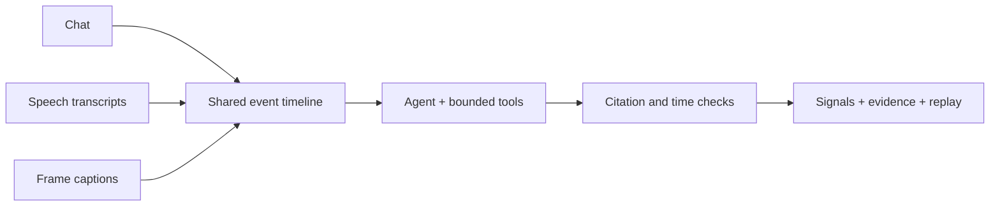

# Twinky

**Understand what Twitch chat is reacting to.**

A live chat moves fast. A burst of guesses, questions or warnings often makes little sense without the moment on stream that triggered it. Twinky combines chat messages, speech transcripts and screen captions on a shared timeline, then turns that context into audience-signal cards with inspectable evidence.


*Recorded replay: deterministic chat grouping; context links are hypotheses. The screenshot
shows a historical gate ledger; see [gate versions](docs/GATE_VERSIONS.md) for current checks.*

## What Twinky does

- **Connects the conversation to the stream.** Chat, transcription and sampled frames share timestamps so reactions can be explored alongside nearby stream events.
- **Surfaces candidate signals.** A tool-calling agent proposes reactions, questions and warnings, with the source messages and context it used.
- **Shows the evidence.** A citation/time gate checks whether referenced events exist and are ordered consistently. Rejected cards and their reasons are inspectable; passing the gate does not prove the interpretation is correct.
- **Replays real recordings.** The browser viewer presents chat, a grouped audience board and signal cards without contacting model providers. `make debrief` produces a separate post-stream summary.
- **Exposes an experimental live API.** A bounded backend can check a Twitch channel's status and run capture, transcription, captioning and agent processing. Live provider execution has not yet been validated end to end, and no public website is deployed from this repository.

## Try the recorded demo

Python 3.10+ is required. The recorded demo, tests and evaluation need **no API keys**.

```bash
git clone https://github.com/tolyaho/twinky.git
cd twinky
make setup PYTHON=python3.12
make demo
```

Open [http://127.0.0.1:8000](http://127.0.0.1:8000). The viewer includes **Board**, **Signals** and **Questions** tabs and replay speeds of 1×, 4× and 8×.

Run the tests and reproduce the cached comparison:

```bash
make test
make eval
```

`make eval` uses recorded model responses, with **48 cache hits and zero API calls**. Cache misses fail rather than calling a provider. See the [reproduction guide](docs/REPRODUCTION.md).

## How it works



The agent can inspect chat, transcripts, frame captions and repeated-message groups. Every run has bounded steps and tool calls. Raw responses, validation decisions and recorded traces are kept separately, so updated checks do not silently alter historical results. See [architecture](docs/ARCHITECTURE.md) and [gate versions](docs/GATE_VERSIONS.md).

## Evaluation

The small frozen evaluation contains **11 cases** from four captured broadcasts. Results are mixed:

| System | Matched gold signals | Cards failing citation/time checks |
|---|---:|---:|
| Tool-calling agent | 2 / 11 | 14 / 23 (60.9%) |
| Direct multimodal baseline | 1 / 11 | 13 / 21 (61.9%) |
| Chat-only diagnostic | 1 / 11 | 7 / 25 (28.0%) |

The gold labels are model-drafted and not human-confirmed; some case windows overlap. No matched prediction correctly names a speech or frame cause. These figures describe an exploratory comparison, **not product accuracy**. Read the [evaluation protocol](docs/EVALUATION.md), [experiment history](docs/IMPROVEMENT_CHANGELOG.md) and [evidence](evidence/summary.json).

## Live integration

The authenticated session API supports channel lookup, session start/status, progress events over SSE and cancellation. It is configured for a restricted beta and is disabled by default. A public multi-user deployment still needs infrastructure-level rate limits, resource quotas, provider budgets, privacy review and a live-network smoke test. See [live integration guide](docs/LIVE_DEMO_INTEGRATION.md).

## Documentation and licence

Code is available under [MIT](LICENSE). Third-party Twitch recordings, viewer messages and derived media are **not** covered by that licence; see [data provenance and retention](evals/DATA.md) before redistributing them. Project history, reconstructed-date disclosure and coding-agent assistance are documented in
[implementation notes](trajectories/coding-agents/README.md).
